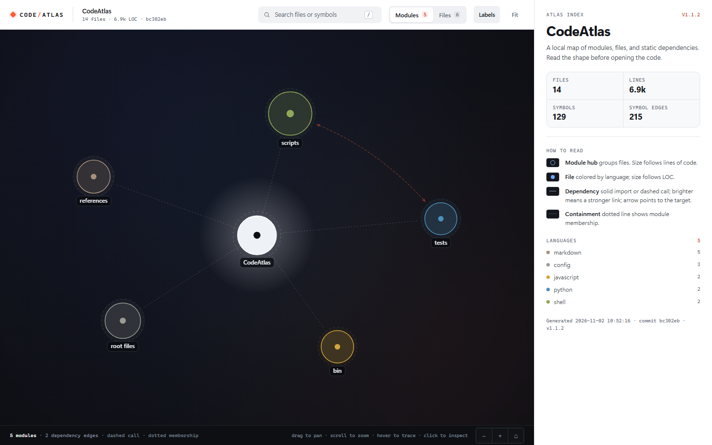

# CodeAtlas

**A map before the read.**

[](https://github.com/hungson1002/CodeAtlas/actions/workflows/ci.yml)
[](https://skills.sh/hungson1002/CodeAtlas)

CodeAtlas is a small, dependency-free codebase atlas for AI coding agents and
the humans who supervise them. Build an index once, then answer the questions
that usually cost a dozen file reads: *where is this symbol, what depends on
it, what breaks if I change it, which tests should I run, and how do I get from
A to B?*

It is a skill (instructions + a CLI) rather than a service. There is no graph
database, no embeddings, no LLM call during build, and no network access.



```text
CODEATLAS.md            compact map, commit this (~2–4k tokens)
.code-atlas/index.json  local graph + incremental cache (gitignored)
.code-atlas/diagram.mmd Mermaid dependency graph
.code-atlas/atlas.html  self-contained interactive map (no CDN)
```

## Install

One command, straight from GitHub — no npm publish required:

```bash
npx skills add hungson1002/CodeAtlas -g
```

`-g` installs globally to `~/.agents/skills/code-atlas` and links it into the
agents detected by the [skills CLI](https://github.com/vercel-labs/skills).
Omit `-g` to install into the current repository instead.

```bash
# pick agents, or run non-interactively
npx skills add hungson1002/CodeAtlas -g -a claude-code -a codex -a opencode -a cursor
npx skills add hungson1002/CodeAtlas -g -y --copy

# inspect before installing
npx skills add hungson1002/CodeAtlas --list
```

The `skills` CLI needs Node 22.20+. The atlas engine itself needs Python 3.9+.
Browse the listing and security audit at
[skills.sh/hungson1002/CodeAtlas](https://skills.sh/hungson1002/CodeAtlas).

Prefer CodeAtlas's own installer (Node 18+, all five agents in one go):

```bash
npx github:hungson1002/CodeAtlas install

# or keep the CLI around
npm i -g github:hungson1002/CodeAtlas
code-atlas install
code-atlas status
```

## Why

Agents are expensive when they explore by `ls`, `grep`, and whole-file reads.
Most of that context is thrown away. CodeAtlas front-loads the structure into a
cheap artifact and answers follow-up questions with a few hundred tokens:

| Task | Without atlas | With atlas |
|---|---|---|
| Find a symbol | grep + open 3–10 files | `where` → one path:line |
| Scope a change | guess at importers | `impact` → direct/transitive + tests |
| Understand architecture | read READMEs and dirs | `CODEATLAS.md` + diagram |
| Give an agent context | concatenate files | `pack` under a budget |

The index is deterministic and local. Builds are incremental (size + mtime),
and writes are atomic, so an interrupted build cannot corrupt the last good
index.

## Quick start

Requires Python 3.9+ (stdlib only). If you installed the global CodeAtlas CLI,
use `code-atlas` directly; otherwise call the installed engine.

```bash
# from a repository, with the global CLI
code-atlas init
code-atlas map
code-atlas where Session
code-atlas impact src/requests/api.py
code-atlas impact --changed
code-atlas pack auth --budget 8000
code-atlas diagram --open

# or call the installed skill
python ~/.agents/skills/code-atlas/scripts/atlas.py init
```

On Windows use `python`; on macOS/Linux `python3` works too. Any command accepts
`-C <repo>` so you can query without changing directories.

## Commands

| Command | What it does |
|---|---|
| `init` | Create `.codeatlas.json`, add `.code-atlas/` to `.gitignore`, build |
| `build` | Build the index and outputs; `--full` ignores the cache |
| `update` | Incremental refresh after edits |
| `map` | Print the compact map; `--budget`, `--write` |
| `where <symbol>` | Locate declarations with kind, signature, call counts |
| `impact <target>` | Reverse dependencies, risk score, incoming calls, tests |
| `impact --changed` | Blast radius and tests for files changed in the working tree; `--staged`, `--base <rev>` |
| `path <a> <b>` | Shortest dependency path between files or symbols |
| `pack <focus>` | Related files under a token budget |
| `diagram` | Write Mermaid + interactive HTML; `--files`, `--top` |
| `doctor` | Check freshness, coverage, unresolved relative imports, parse errors; `--fix` rebuilds |
| `stats` | Files, LOC, symbols, edges, languages, test command |

Targets can be a file (`src/api.py`), a symbol (`AuthService.login`), or a
directory/module (`src/requests`). Add `--json` for machine-readable output.
Lists are capped by `--limit`; JSON also reports `total` and `*_count` so
truncation is visible.

`impact --changed` reads the git working tree (staged, unstaged, and untracked
files), expands importers up to `--depth`, and reports the tests to run. Use
`--staged` to limit it to the index, or `--base <rev>` to compare against a
branch. Changed paths outside the index are listed as skipped rather than
guessed. Run `update` first when files were added or removed.

## Project resolution

Import edges are only useful if they point at real files. In addition to
relative imports, CodeAtlas reads the project's own resolution config:

- `tsconfig.json` / `jsconfig.json` — JSONC comments and trailing commas,
  `extends`, project `references`, `baseUrl`, and `paths` aliases such as
  `@shared/*`. Paths are resolved relative to the config that declares them.
- NodeNext-style imports — `./b.js` resolves to `b.ts` when no emitted `.js`
  file exists. A real `.js` file still wins.
- Workspace packages — `package.json` `workspaces` and `pnpm-workspace.yaml`
  patterns; each package's `exports`, `types`, `module`, and `main` fields are
  used to map `@scope/pkg/sub` to its source file.
- Python and JVM dotted imports, directory indexes, and unique suffix matches.

Everything is read from the repository; no package manager or network access is
involved. `doctor` still lists relative imports that resolve to no indexed file,
which is the quickest way to spot a missing alias or workspace entry.

## What the map contains

- Entrypoints with reasons (conventional name, package API surface, nothing
  imports it).
- Modules with file/LOC counts, dependency weights, and key exported symbols.
- Hot files ranked by PageRank over the import graph.
- Test count and a detected test command (`pytest`, `npm test`, `go test`,
  `cargo test`, etc.). Very long `package.json` test scripts are summarized as
  `npm test`/`pnpm test`/`yarn test`/`bun test` so the map stays small.
- Query recipes so a fresh agent knows what to run next.

The interactive HTML map has two views:

- **Modules** — architecture at a glance. Module nodes are sized by LOC and
  colored by language, with dotted membership links from the repository root.
  Import and cross-file call edges are drawn between modules when they exist.
- **Files** — code files grouped into module clusters, with import arrows (solid) and
  cross-file calls (dashed). Dotted lines show which module owns each file.
  Search, pan/zoom, and the click-through inspector work in both views.

The layout is computed once from the index and kept stable, so nodes do not
drift or flicker while the page is open. Open
`.code-atlas/atlas.html` directly in a browser. Start in file view with
`atlas.html#files` or `diagram --files`. Everything is embedded in one file;
there is no CDN or server requirement.

### Analysis on the map

- **Impact** — select a node, then choose *Dependents*, *Depends on*, or
  *Both* at 1–3 hops. The map dims everything outside the radius and colors
  direct and transitive dependents separately. Use `i` as a shortcut.
- **Trace path** — start from a selected node, then click a second node (or
  `Shift`-click from anywhere) to highlight the shortest import/call path.
  Use `p` as a shortcut; paths are capped at 8 hops and fall back to the
  reverse direction when no forward path exists.
- **Layers** — open the layer button in the map footer to show or hide
  imports, calls, and containment. Analysis edges stay visible even when their
  layer is hidden.
- **Deep links** — selection, impact settings, paths, hidden layers, and label
  state are encoded in the URL hash, for example
  `#files?node=services/auth.py&impact=in-2&edges=cm&labels=0`. Browser Back
  returns to the previous selection.

Impact and path analysis use only indexed import and call edges. Containment
shows module membership; it is never treated as a dependency. Selecting a new
node clears the current analysis so the map always reflects the latest focus.

## Benchmarks

Measured on a Windows laptop, Python 3.14, cold build (`--full`):

| Repository | Files | LOC | Symbols | Edges | Build |
|---|---:|---:|---:|---:|---:|
| `psf/requests` | 73 | 17.8k | 687 | 1,051 | ~1.0 s |
| `expressjs/express` | 149 | 26.6k | 213 | 389 | ~0.45 s |
| CodeAtlas skill | 11 | 4.2k | 81 | 116 | ~0.16 s |

Incremental `update` reuses unchanged files and is typically much faster. The
map for `requests` fits in roughly 1–2k tokens at the default budget.

## Agent install details

The repository root is the skill: `SKILL.md` at the root, engine in `scripts/`.
The skills CLI copies the whole folder, so `scripts/atlas.py` and `references/`
stay available after install.

Default global destinations:

| Agent | Path |
|---|---|
| OpenCode | `~/.config/opencode/skills/code-atlas` |
| Claude Code | `~/.claude/skills/code-atlas` |
| Codex CLI | `~/.codex/skills/code-atlas` |
| Cursor | `~/.cursor/skills/code-atlas` |
| Universal | `~/.agents/skills/code-atlas` |

Project-scoped alternatives are `.opencode/skills/`, `.claude/skills/`,
`.cursor/skills/`, and `.agents/skills/`. Agents that only read project
instructions can use the `AGENTS.md` snippet in
`references/agent-setup.md`.

### From a clone (offline)

```powershell
# Windows
.\scripts\install.ps1 -Force
```

```bash
# macOS / Linux
./scripts/install.sh --force
```

### CodeAtlas installer options

```bash
npx github:hungson1002/CodeAtlas install --agent claude,codex
npx github:hungson1002/CodeAtlas install --project --agent claude
npx github:hungson1002/CodeAtlas install --link --force
npx github:hungson1002/CodeAtlas status
npx github:hungson1002/CodeAtlas uninstall
```

`--link` keeps one canonical copy in `~/.agents/skills/code-atlas` and creates
junctions/symlinks for the other agents. `--force` replaces an existing copy.
The installer never needs npm lifecycle scripts, so it works with npm's
script-blocking defaults.

## Configuration

`.codeatlas.json` (all keys optional):

```json
{
  "exclude": ["generated", "fixtures/large"],
  "include": ["bin"],
  "max_file_kb": 512,
  "module_depth": 2,
  "budget": 3500,
  "entrypoints": ["cmd/server/main.go"],
  "test_command": "npm test",
  "git_churn": true,
  "map_file": "CODEATLAS.md"
}
```

Excludes are additive to built-in defaults and `.gitignore`. Secrets, binaries,
lockfiles, and common build/vendor directories are skipped by default. `include`
opts specific paths back in when a default or `.gitignore` rule would hide them,
for example a hand-written `bin/cli.js`. It only overrides path exclusion:
secret, binary, lockfile, and size checks still apply.
`git_churn` counts recent commits per file and feeds the impact risk score.
`test_command` overrides auto-detection. When a `package.json` test script is
very long (for example a generated list of every test file), the map reports
`npm test` (or `pnpm`/`yarn`/`bun test` based on the lockfile) instead of
echoing the whole command, keeping the committed map small.

## Design

Three layers, deliberately small:

- **L0 — Map:** `CODEATLAS.md`, cheap enough to read at the start of every task.
- **L1 — Graph:** local JSON index queried by `where`, `impact`, `path`, `pack`.
- **L2 — Visual:** Mermaid and a self-contained, deterministic HTML atlas.

No graph DB, no embeddings, no build-time LLM, no mandatory external tools. The
design borrows the useful parts of existing projects — incremental indexing and
blast radius from code-review-graph, deterministic ranked output from ripwire,
a commit-friendly map from stacklit, docs/config nodes from Graphify, and
budgeted packing from repomix — without making any of them dependencies. See
`references/design-notes.md` for the full rationale and non-goals.

## Supported languages

| Tier | Languages |
|---|---|
| Best (AST) | Python |
| Good (regex + heuristics) | TypeScript, JavaScript |
| Basic (regex) | Go, Rust, Java, Kotlin, C#, Ruby, PHP, Swift, Scala, Lua, C, C++, Objective-C, shell |
| Nodes only | Markdown, JSON, YAML, TOML, INI, SQL |

Call graphs are best-effort. Dynamic imports, reflection, dependency injection,
and macro-generated code may be missed. CodeAtlas is for orientation and impact
scoping; use an LSP or semantic tool for precise rename/reference operations.

## Development

```bash
python -m py_compile scripts/atlas.py
python -m unittest discover -s tests -v   # engine
node --test tests/test_cli.cjs            # installer / npm CLI
npm test                                  # both
```

The engine suite builds temporary fixtures and exercises the CLI end to end:
indexing, secret exclusion, relative imports, NodeNext `.js` mapping, tsconfig
`paths`/`baseUrl` and workspace packages, TS class methods, `where`, `impact`
(including `--changed`), `path`, `pack`, `diagram`, and stale → update → fresh
recovery. The Node suite covers install, update, link, project scope, status,
uninstall, and Python passthrough.

## License

MIT. See `LICENSE`.
